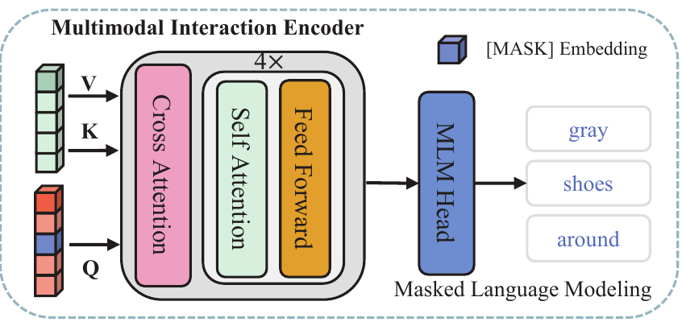
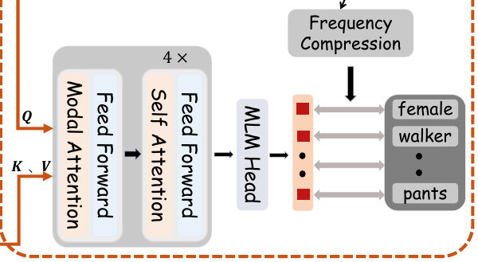
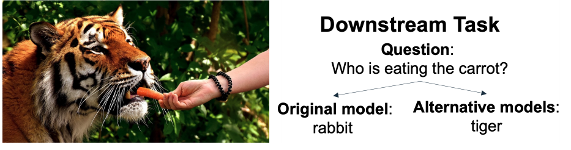

<div align="center">

# Enhanced IRRA
### Find a person. Start with a description.

A research project that teaches images and words to understand the same details.

[**Open the notebook**](Enhanced_IRRA_RSTPReid.ipynb) · [**How it works**](#how-it-works) · [**Results**](#results)


</div>

> **“A woman riding a yellow bicycle, wearing a long pink coat and black leggings.”**


The model turns the description into a visual signature, then finds the closest images in a gallery of **1,000 photos**. These are real model rankings captured from the project's research interface.

<details>
<summary><strong>Different details, different results: a red bag and a striped sweater</strong></summary>

**“A person in a black-and-white patterned coat and black leggings, carrying a red bag.”**


**“A man in a striped sweater and dark trousers, holding a coat in his hand.”**


The numbers shown are cosine similarities, not confidence percentages. Matching an appearance does not verify a real-world identity. [Recorded search evidence](research/illustrated-searches.json).

</details>

## How it works


1. **Start with CLIP:** a model that already connects images and language.
2. **Teach person-specific details:** bring matching photos and descriptions closer together.
3. **Hide meaningful phrases:** make the model use the photo to recover missing words, such as *pink coat*.

The model combines phrase masking with frequency-weighted word prediction. Both encoders are fine-tuned; the extra learning heads are unnecessary for retrieval. [Original illustration, PNG](assets/architecture.png) · [Implementation](src/enhanced_irra/model.py)

## Ideas we used from the papers

### IRRA — connect photos and descriptions



*Figure 2 excerpt, PDF page 4. Jiang & Ye · CVPR 2023. [Source paper](https://arxiv.org/pdf/2303.12501#page=4).*

**What we used:** the CLIP image/text backbone, similarity matching, shared identity learning, and cross-attention that uses the photo to recover missing words.

### KPDM — keep descriptive phrases together



*Figure 3(b) excerpt, PDF page 4. You et al. · AAAI 2026. [Source paper](https://ojs.aaai.org/index.php/AAAI/article/download/38199/42161#page=4).*

**What we adapted:** mask adjective–noun phrases, such as *black jacket*, and reduce the influence of very frequent words. Our phrase detector uses a fixed visual vocabulary.

### Data Efficient MLM — choose words that need the image



*Figure 1 excerpt, PDF page 1. Bitton et al. · EMNLP 2021. [Source paper](https://aclanthology.org/2021.findings-emnlp.259.pdf#page=1).*

**What inspired our approach:** prioritize visual words—clothing, colors, and objects—over easily guessed filler words, so the photo contributes to learning.

These are cropped screenshots from the original papers. The architecture illustration above and the retrieval results belong to this project.

## Results

| On the validation set | Result | In everyday language |
|---|---:|---|
| First result is relevant | **43.15%** | The correct dataset identity is ranked first. |
| Relevant result within five | **61.15%** | The correct identity appears among the first five images. |
| Overall ranking quality | **36.04% mAP** | Measures how well all relevant images are placed. |

## Explore the research

| File | What you will find |
|---|---|
| [Notebook](Enhanced_IRRA_RSTPReid.ipynb) | Short explanations, executed plots, masking examples, and conclusions |
| [Research evidence](research/) | Actual training histories, results, comparisons, and source provenance |
| [Model implementation](src/enhanced_irra/) | Encoders, losses, masking, training, and evaluation |
| [Experiment configurations](configs/) | Exact settings used for the original experiments |

<details>
<summary><strong>Run the notebook locally</strong></summary>

Python 3.11 and [uv](https://docs.astral.sh/uv/getting-started/installation/) are required. Run from the cloned repository:

```bash
uv sync --frozen --extra notebook --extra dev
uv run --frozen --extra notebook jupyter lab Enhanced_IRRA_RSTPReid.ipynb
```

The notebook analyzes included results and small teaching examples. It does not download a dataset, train a model, run live retrieval, or evaluate held-out test images. Model weights and the full dataset are excluded from this public repository.

Software checks: `uv run --frozen --extra dev pytest -q`.

</details>

Built on [IRRA · CVPR 2023](https://arxiv.org/abs/2303.12501), with selected masking ideas from [KPDM · AAAI 2026](https://ojs.aaai.org/index.php/AAAI/article/view/38199) and [Data Efficient MLM · EMNLP 2021](https://aclanthology.org/2021.findings-emnlp.259/). Dataset: [RSTPReid](https://github.com/NjtechCVLab/RSTPReid-Dataset). [Attribution](THIRD_PARTY_NOTICES.md).
