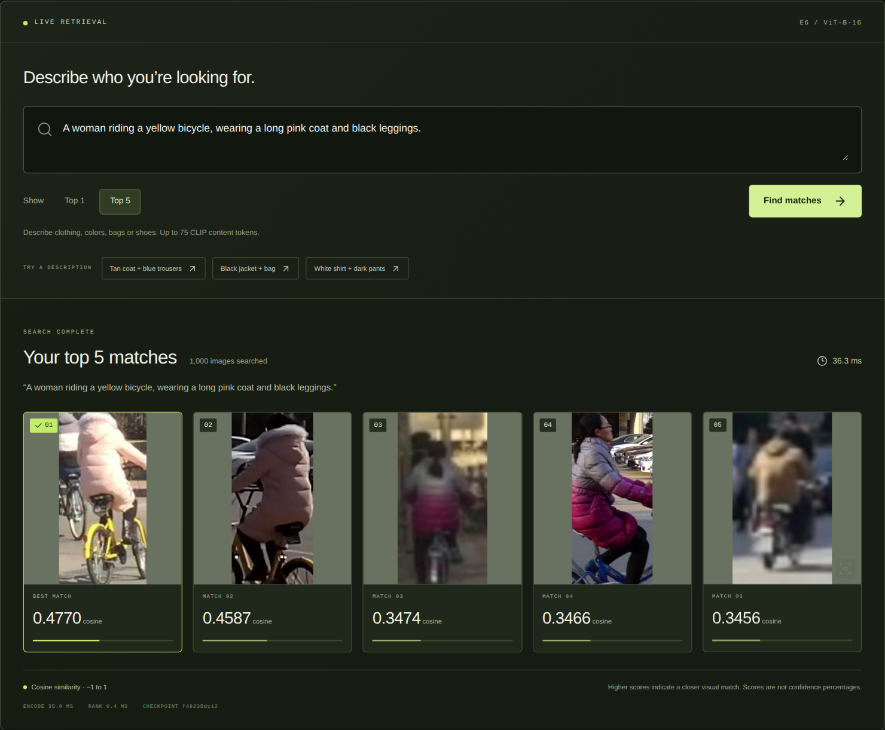
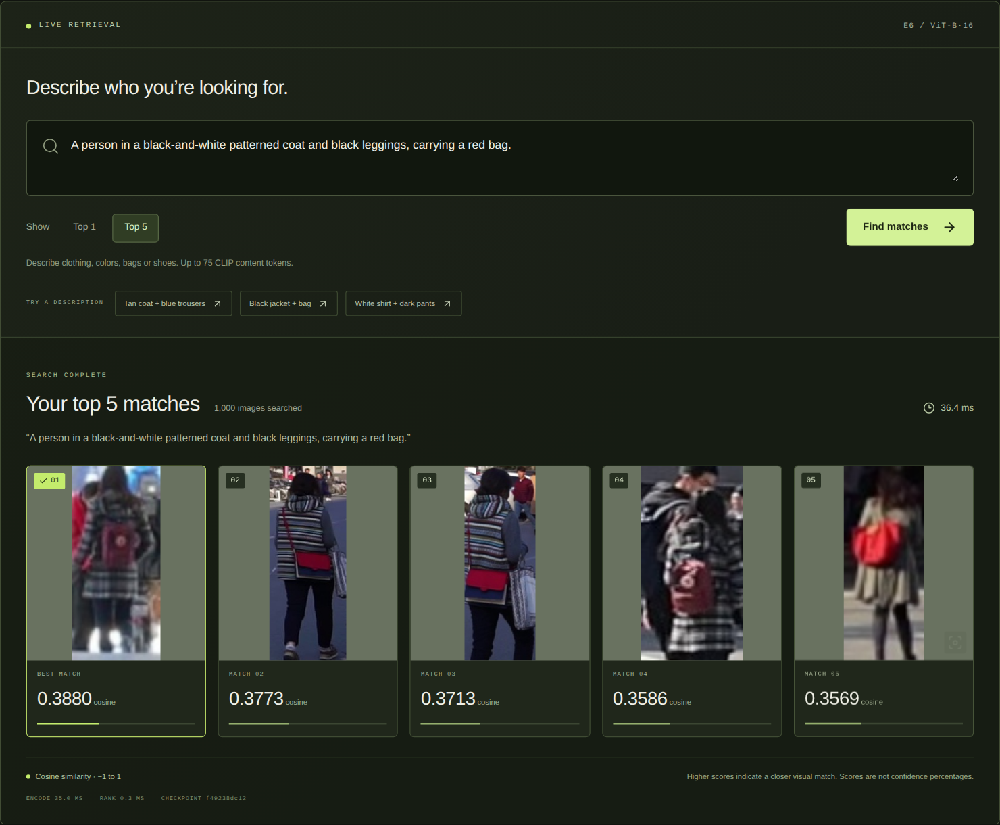
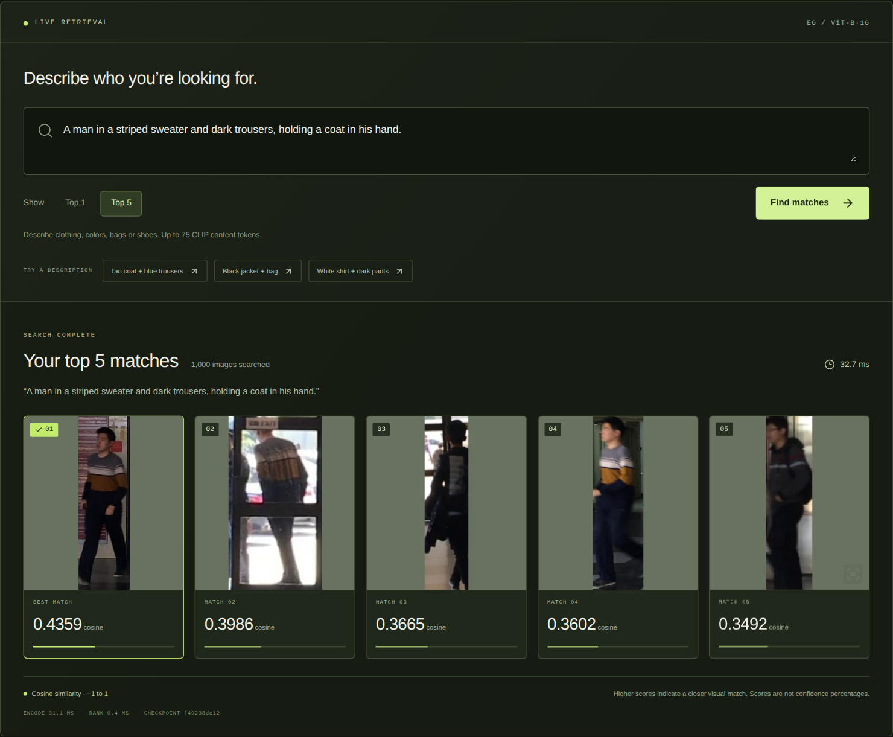
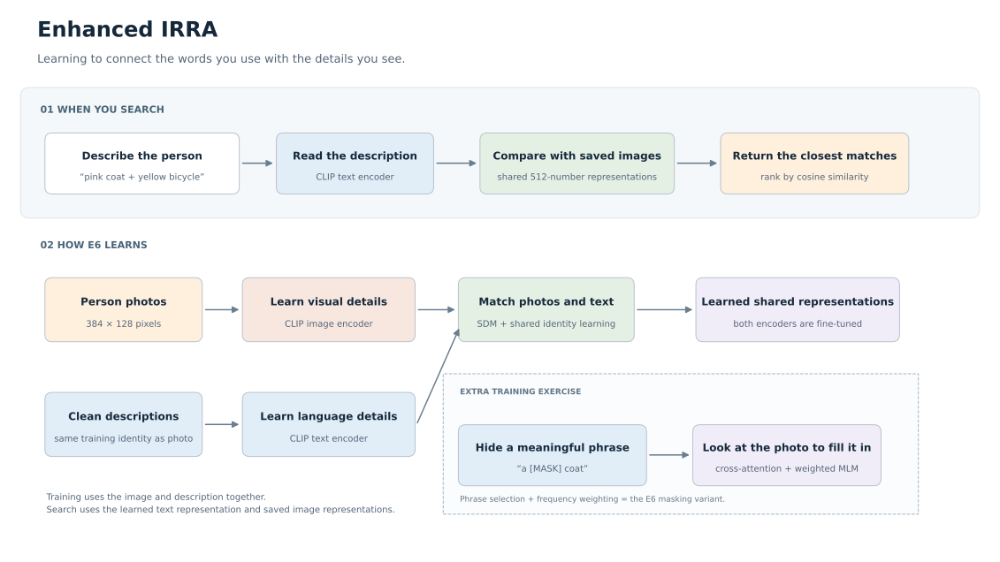

<div align="center">

# Enhanced IRRA
### Find a person. Start with a description.

A research project that teaches images and words to understand the same details.

[**Open the notebook**](Enhanced_IRRA_RSTPReid.ipynb) · [**How it works**](#how-it-works) · [**What we learned**](#what-we-learned)


</div>

> **“A woman riding a yellow bicycle, wearing a long pink coat and black leggings.”**



The model turns the description into a visual signature, then finds the closest images in a gallery of **1,000 photos**. These are real model rankings from the project's research interface. This repository presents the research; it does not host or ship a web application.

<details>
<summary><strong>Different details, different results: a red bag and a striped sweater</strong></summary>

**“A person in a black-and-white patterned coat and black leggings, carrying a red bag.”**



**“A man in a striped sweater and dark trousers, holding a coat in his hand.”**



The numbers shown are cosine similarities, not confidence percentages. Matching an appearance does not verify a real-world identity. [Recorded search evidence](research/illustrated-searches.json).

</details>

## How it works



1. **Start with CLIP:** a model that already connects images and language.
2. **Teach person-specific details:** bring matching photos and descriptions closer together.
3. **Hide meaningful phrases:** make the model use the photo to recover missing words, such as *pink coat*.

E6 combines this phrase masking with frequency-weighted word prediction. Both encoders are fine-tuned; the extra learning heads are unnecessary for retrieval. [Original illustration, PNG](assets/architecture.png) · [Implementation](src/enhanced_irra/model.py)

## What we learned

| On the validation set | Result | In everyday language |
|---|---:|---|
| First result is relevant | **43.15%** | The correct dataset identity is ranked first. |
| Relevant result within five | **61.15%** | The correct identity appears among the first five images. |
| Overall ranking quality | **36.04% mAP** | Measures how well all relevant images are placed. |

**2,000 descriptions · 1,000 images · RSTPReid · seed 17.** The selected E6 checkpoint is epoch 9 of the original ten-epoch run. Four duplicate training images were excluded before training.

**More epochs did not automatically help.** An additional fine-tuning experiment was stopped after 16 completed epochs. Its best Rank-1 was 43.35%, with slightly lower mAP (36.00%); the last epoch reached 39.45% / 34.13%. The original E6 remains selected.

These are preliminary validation results. A matched full-data baseline, repeated-seed study, and held-out test evaluation remain outstanding. E6 adapts selected masking ideas; this is not a complete KPDM reproduction.

## Explore the research

| File | What you will find |
|---|---|
| [Notebook](Enhanced_IRRA_RSTPReid.ipynb) | Short explanations, executed plots, masking examples, and conclusions |
| [Research evidence](research/) | Actual training histories, results, comparisons, and source provenance |
| [Model implementation](src/enhanced_irra/) | Encoders, losses, masking, training, and evaluation |
| [Experiment configurations](configs/) | Exact settings used for the original experiments |

<details>
<summary><strong>Run the notebook locally</strong></summary>

Python 3.11 and [uv](https://docs.astral.sh/uv/getting-started/installation/) are required. Run from the cloned repository:

```bash
uv sync --frozen --extra notebook --extra dev
uv run --frozen --extra notebook jupyter lab Enhanced_IRRA_RSTPReid.ipynb
```

The notebook analyzes included results and small teaching examples. It does not download a dataset, train a model, run live retrieval, or evaluate held-out test images. Model weights and the full dataset are excluded from this public repository.

Software checks: `uv run --frozen --extra dev pytest -q`.

</details>

Built on [IRRA · CVPR 2023](https://arxiv.org/abs/2303.12501), with selected masking ideas from [KPDM · AAAI 2026](https://ojs.aaai.org/index.php/AAAI/article/view/38199) and [Data Efficient MLM · EMNLP 2021](https://aclanthology.org/2021.findings-emnlp.259/). Dataset: [RSTPReid](https://github.com/NjtechCVLab/RSTPReid-Dataset). [Attribution](THIRD_PARTY_NOTICES.md).
